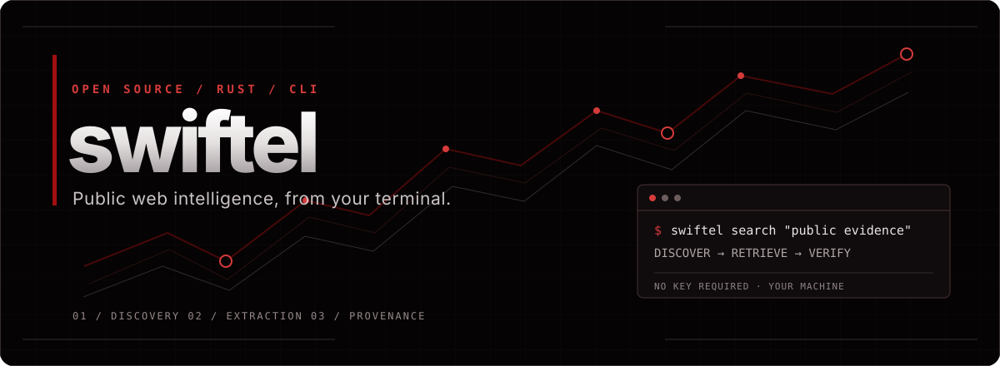

<div align="center">



<br />

**Search. Retrieve. Verify.** A small, open-source Rust CLI for public web research.

[](LICENSE)


</div>

---

### One tool. Five focused operations.

| Command | Purpose | Evidence returned |
| :--- | :--- | :--- |
| `search` | Find public pages via an optional self-hosted SearXNG instance or keyless search fallback | Ranked links, titles, snippets, origin, query, timestamp |
| `fetch` | Retrieve and extract a public HTML page | Title, text, links, final URL, response status, SHA-256, timestamp |
| `crawl` | Follow links on the same site, within a strict budget | Page records and failed URLs; robots-aware |
| `promo` | Look for published software offer strings | Literal codes with source excerpts; **not redemption claims** |
| `domain` | Query public CT and web-archive metadata | Scoped host/history observations and per-source errors |

No account, token, paid search API, tracking endpoint, or hosted Swiftel service. The destination sites and selected search engine still receive normal network requests.

### Start in under a minute

```bash
git clone <YOUR-PUBLISHED-SWIFTEL-REPOSITORY-URL>
cd Swiftel
cargo build --release
./target/release/swiftel --help
```

The clone URL is intentionally a placeholder until this repository is published; do not use it literally. Requires a current stable Rust toolchain and outbound network access. Binary builds locally; there are no runtime language runtimes or services for basic commands.

```bash
# Discover relevant public pages
swiftel search 'rust web scraping guide' --limit 5

# Retrieve a known public page
swiftel fetch https://example.com --json

# Explore one site with a small budget
swiftel crawl https://example.com --max-pages 5 --max-depth 1 --json

# Look for literal, published offers; never touches checkout
swiftel promo 'Example Software' --json

# Passive certificate/archive context (not an active scan)
swiftel domain example.com --json
```

When running from the checkout without installing:

```bash
cargo run -- search 'rust web scraping guide' --limit 5
```

Set `SWIFTEL_SEARXNG_URL` to the URL of your own [SearXNG](https://docs.searxng.org/) JSON-enabled instance, or use `--searxng URL` with `search`/`promo`. A local instance isolates queries from commercial search APIs but still forwards requests to its configured upstream engines. Instance availability and engine rate limits affect coverage; zero results do **not** establish that nothing exists.

### How Swiftel thinks

```text
 PUBLIC QUERY                  KNOWN URL                   DOMAIN
     │                            │                          │
     ▼                            ▼                          ▼
 search backend            safe HTTP fetch             public CT + archive
     │                            │                          │
     └─────────► source + timestamp + bounded results ◄──────┘
                              │
                              ▼
                    inspect original evidence
                    classify / corroborate
```

Research is an evidence pipeline, not a count of search hits. A snippet is a lead. An archived page has a date. A coupon string printed on an old page is not a working discount. Swiftel carries provenance and reports extraction or source failures instead of filling gaps with guesses. The [research playbook](docs/RESEARCH_PLAYBOOK.md) collects anonymized lessons from varied public-source investigations and offer searches without including any case material or personal queries.

### Safe by default

- Public HTTP(S) only: rejects non-web schemes, credentials in URLs, and private/loopback/link-local/reserved destinations by default. Redirect destinations are checked again.
- Bounded fetches and crawls: body-size, timeout, redirect, page-count and depth caps. Crawl stays within the original origin and respects `robots.txt` and polite delays.
- No JavaScript execution, login, CAPTCHA solving, stealth evasion, active network scans, or private-data enrichment.
- `--allow-private` is only for controlled local fixtures. Never enable it for an untrusted URL or expose a wrapper that passes arbitrary URLs with this flag.
- Results may contain web-page text: review before publishing or sending to a third party. Swiftel's JSON output is not an investigative conclusion.

See [SECURITY.md](SECURITY.md) for the threat model and disclosure route. Contribute with tests following [CONTRIBUTING.md](CONTRIBUTING.md).

### Architecture

```text
src/
  main.rs          argument routing and output
  search.rs        keyless/SearXNG discovery and normalization
  fetch.rs         safe bounded HTTP retrieval
  extract.rs       HTML extraction
  robots.rs        access rules and crawl delay
  crawl.rs         scoped, robots-aware traversal
  promo.rs         published-code lead extraction
  domain.rs        passive structured lookups
```

The modules are small so that changing a search provider does not require changing page parsing or crawl policy. JSON output is meant for piping into `jq` or an investigator's evidence store; this CLI does not collect or upload your case files.

### The comparison, honestly

Swiftel is free, locally run, open source, and oriented toward inspectable evidence and bounded collection. Firecrawl also renders JavaScript and operates a hosted browser/crawl platform; SERP API and Brave Search API provide maintained commercial search indexes or aggregation. Swiftel does **not** currently reproduce those indexes, browser rendering, anti-bot infrastructure, global coverage, or an SLA. No benchmark establishes that it outperforms any of them; if a source blocks ordinary HTTP, report the limitation rather than pretending to have extracted it. The practical advantage is control and zero required paid API credentials, not unsupported claims of universal superiority.

### Development

```bash
cargo fmt --all -- --check
cargo clippy --locked --all-targets -- -D warnings
cargo test --locked --all-targets
```

The source is MIT licensed. No real case evidence, account identifiers, API keys, or private research results belong in this repository.
