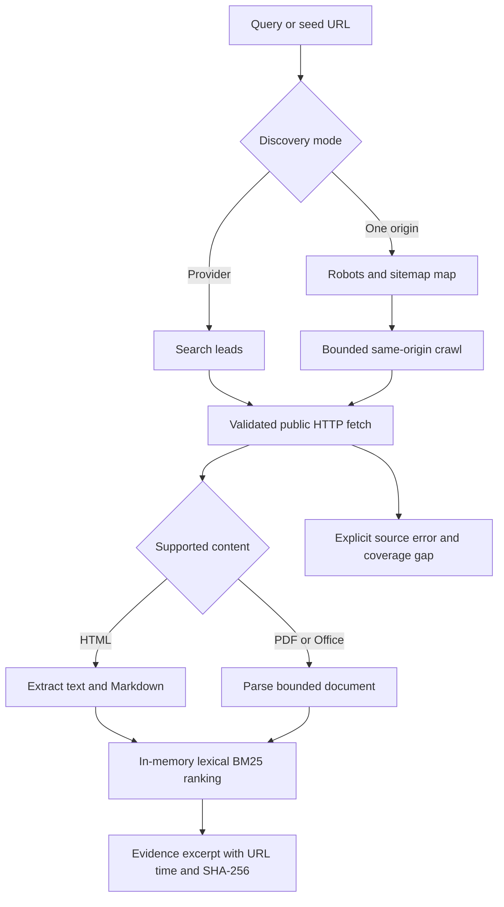
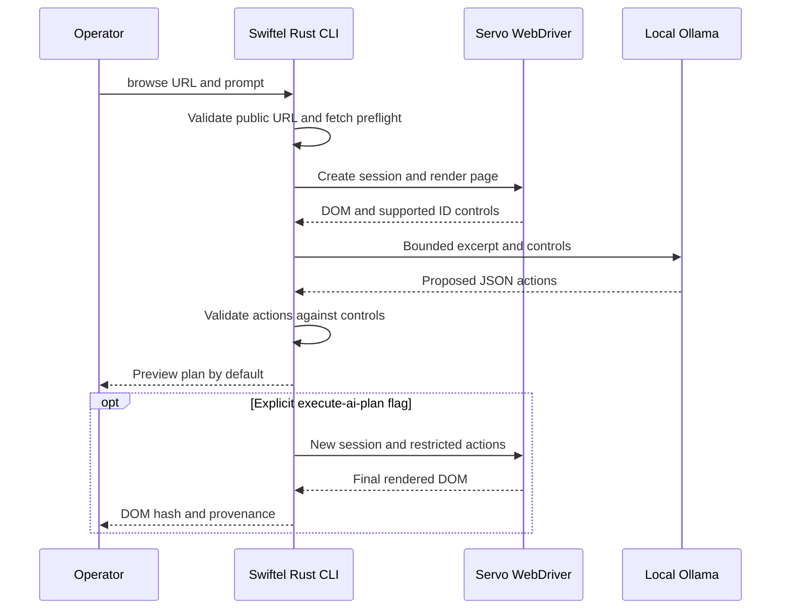

<div align="center">


<br />

**Search. Retrieve. Verify.** A local, evidence-aware Rust CLI for public web research.

[](LICENSE)
[](https://github.com/bobvasic/Swiftelligence/actions/workflows/ci.yml)


</div>

---

### One tool. Focused components.

| Command | Purpose | Output |
| :--- | :--- | :--- |
| `search` | Public search through optional self-hosted SearXNG or keyless fallback | Ranked leads and coverage warnings |
| `fetch` | Retrieve public HTML | Text, Markdown, links, URL, HTTP status, timestamp, SHA-256 |
| `map` | Find URLs from robots sitemaps and same-origin links | Discovery method, depth and per-source failures |
| `crawl` | Follow same-origin links within page/depth budgets | Fetched pages and robots/network failures |
| `research` | Rank fetched HTML/document text by lexical relevance | Source-grounded excerpts, scores, timestamps, hashes |
| `document` | Convert PDF text layers, DOCX, XLSX, PPTX | Markdown, structured JSON, original-byte hash |
| `browse` | Optional Servo-rendered page and restricted interactions | Rendered DOM, permitted controls, optional AI plan |
| `promo` | Find literal offer strings printed on public pages | Excerpts, never redemption claims |
| `domain` | Passive certificate-transparency and archive context | Source observations and errors |

The crate and executable are `swiftel`; the public repository is named Swiftelligence. The CLI itself has no hosted account, tracking endpoint, or required paid API. Destination sites, search providers, and an optional local model still see their respective requests.

### Start locally

```bash
git clone https://github.com/bobvasic/Swiftelligence.git
cd Swiftelligence
cargo build --locked --release
./target/release/swiftel --help
```

A stable Rust toolchain and outbound network are required. Core HTTP commands need no browser process or model. Tagged releases may lag the current `main` branch; see the changelog.

```bash
swiftel search 'rust web scraping guide' --limit 5 --json
swiftel fetch https://example.com --json
swiftel map https://example.com --max-urls 100 --max-pages 5 --json
swiftel crawl https://example.com --max-pages 5 --max-depth 1 --json
swiftel research 'rust browser' --site https://example.com --max-pages 5 --json
swiftel document ./public-report.pdf --json
swiftel promo 'Example Software' --json
swiftel domain example.com --json
```

From a checkout without installing, use `cargo run -- <command> ...`. Set `SWIFTEL_SEARXNG_URL` to your own [JSON-enabled SearXNG](https://docs.searxng.org/) instance to use it for search/promo/research. A local metasearch instance still queries configured upstream engines. A zero-result search is not proof of absence.

### Evidence algorithm



Sitemap entries are leads, not verified fetched pages. The score ranks observed text, not its truth, and the index is in-memory per invocation. `research --site` starts from a bounded crawl; a provider-based research query fetches discovered public HTML or recognized documents. Preserve original sources for investigative conclusions. See [architecture](docs/architecture/OVERVIEW.md), [research](docs/features/RESEARCH.md) and the [playbook](docs/RESEARCH_PLAYBOOK.md).

### Optional headless browser and prompts

Swiftel can control the open-source, non-Chrome [Servo](https://github.com/servo/servo) browser engine through a locally published WebDriver endpoint. Browser actions are JSON `click`, `type`, and `wait`, restricted to same-origin anchors or text/search inputs and short delays. No arbitrary JavaScript, buttons or forms are supported.

```bash
docker build -f infra/browser/Dockerfile -t swiftel-servo:v0.7.0 infra/browser
docker run --rm --name swiftel-servo --cap-drop=ALL --security-opt=no-new-privileges \
  --read-only --tmpfs /tmp:rw,nosuid,size=128m --shm-size=128m \
  --pids-limit=128 --memory=2g --cpus=1 -p 127.0.0.1:7000:7000 swiftel-servo:v0.7.0
# In another terminal:
swiftel browse https://example.com --acknowledge-browser-network-risk --json
```

A local Ollama model may propose an action plan from the rendered page. It is previewed, not executed, unless explicitly requested. To execute the **same reviewed plan**, save `.ai_plan` from the JSON output and use `--actions` (see [browser guide](docs/runtime/SERVO.md)). Running `--execute-ai-plan` directly generates and executes a fresh plan without human preview:

```bash
swiftel browse https://example.org --prompt 'Open the next page' --model YOUR_LOCAL_MODEL \
  --acknowledge-browser-network-risk --json
swiftel browse https://example.org --prompt 'Open the next page' --model YOUR_LOCAL_MODEL \
  --execute-ai-plan --acknowledge-browser-network-risk --json
```



Important: Docker's default bridge is **not** a public-only egress firewall. Browser subrequests and scripts bypass Swiftel's Rust HTTP SSRF checks. Do not browse untrusted sites on hosts with reachable private services unless you have independently enforced public-only egress. WebDriver must stay on loopback; never mount credentials or case files into the browser container. The model sees page text and can misunderstand malicious instructions; review the plan before execution. WebDriver provides no reliable HTTP response status, so `browse` reports `status: 0` and hashes the rendered DOM. [Setup and limitations](docs/runtime/SERVO.md).

### Boundaries

- Standard HTTP fetches validate schemes, credentials, ports and DNS/IP addresses, pin DNS per hop, revalidate redirects, disable implicit proxies, and cap bytes/timeouts.
- Mapping and crawling stay on one origin, honor `robots.txt` and polite delays, and stop at configured limits. No full-web index, login-only/deep-web access, anti-bot bypass or unlimited crawling.
- PDF extraction needs a text layer. No OCR, legacy Office parsing, document fidelity guarantee, or semantic claim validation. Parse hostile documents under OS memory/CPU limits.
- `--allow-private` disables network protection and exists only for controlled localhost fixtures. Do not expose an untrusted URL wrapper with that flag.
- The CLI is implemented in Rust. The optional Servo browser is a separately distributed Rust engine with native runtime libraries; it was not rewritten as part of this project. No Firecrawl code is bundled. No benchmark establishes superiority over Firecrawl, SERP APIs, or commercial browser fleets.

See [documentation index](docs/README.md), [security policy](SECURITY.md), and [release history](CHANGELOG.md).

### Development

```bash
cargo fmt --all -- --check
cargo clippy --locked --all-targets -- -D warnings
cargo test --locked --all-targets
cargo build --locked --release
```

MIT-licensed Swiftel source; the separately distributed Servo runtime has its own license. Do not commit case evidence, tokens, private research results, or browser profiles.
